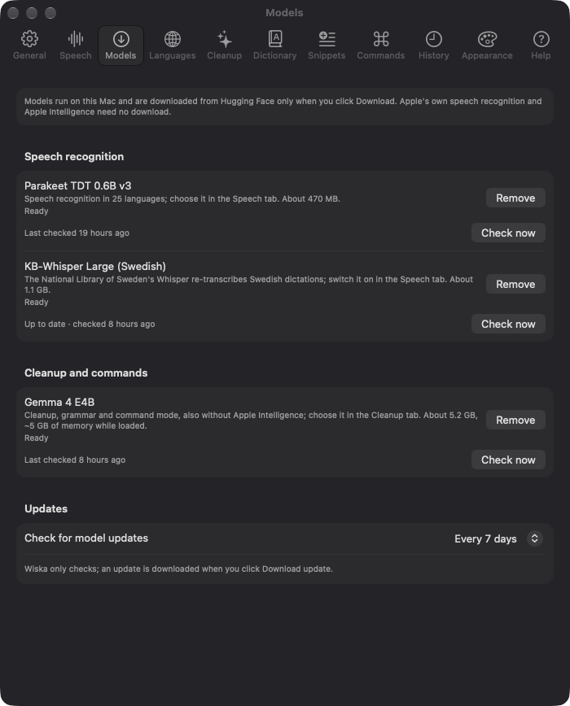
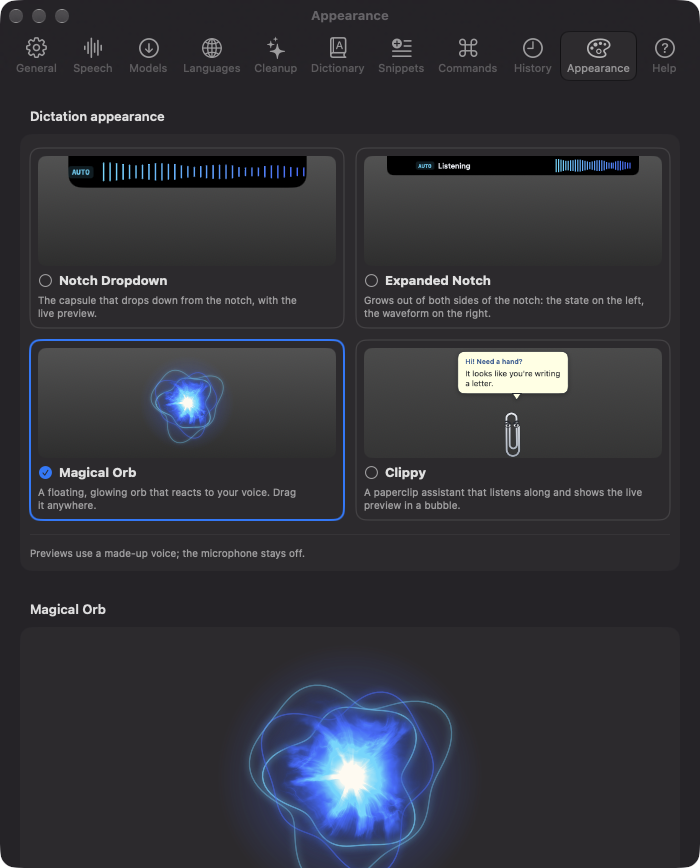
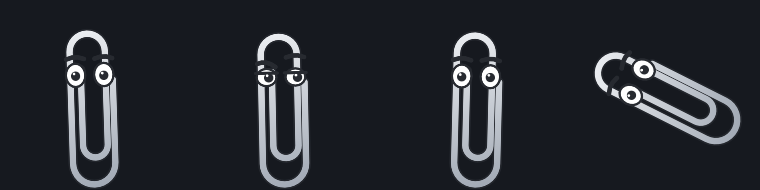
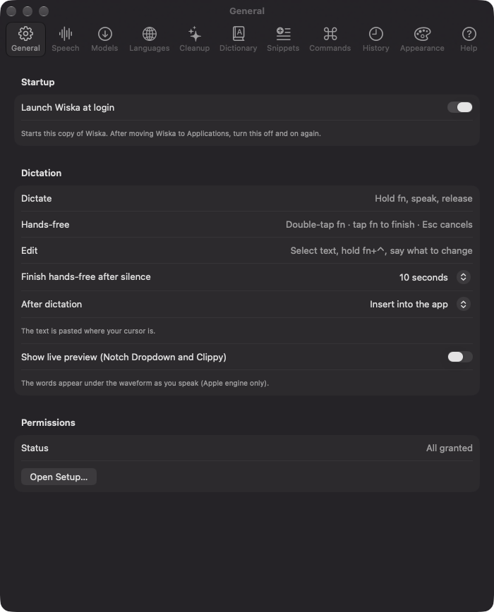
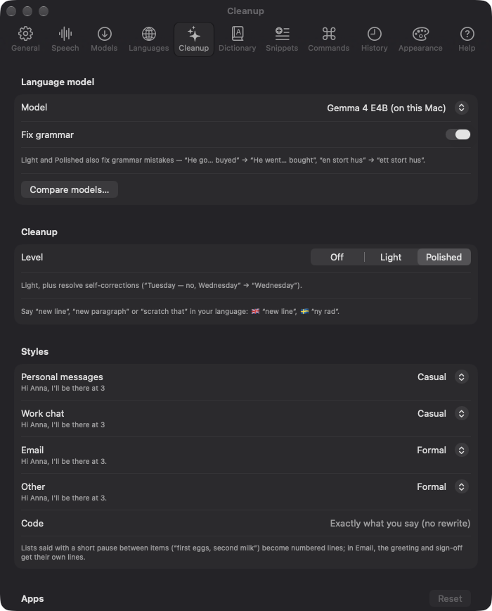
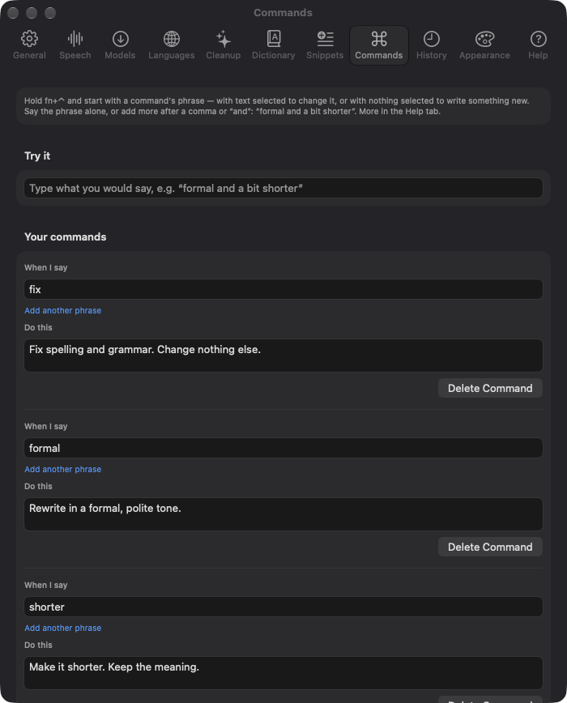
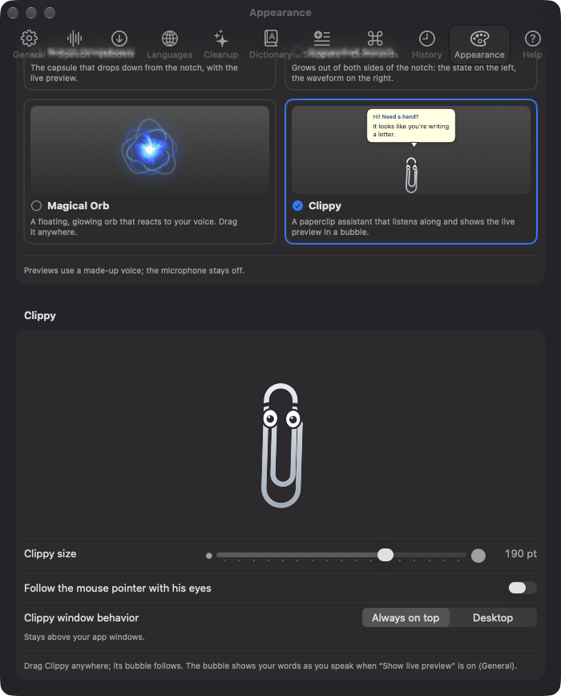

# Wiska

Private, on-device dictation for macOS. Hold **fn**, speak, release — your words appear wherever the cursor is, cleaned up and formatted for the app you're in. Nothing you say leaves your Mac.

<p align="center">
  
</p>

## Download

**[Download Wiska for macOS (Wiska.zip, about 19 MB)](https://github.com/jozeta/Wiska/releases/latest/download/Wiska.zip)** — or see all [releases](https://github.com/jozeta/Wiska/releases).

Requires macOS 26 or later on Apple Silicon. Unzip and move **Wiska.app** to your Applications folder.

### "Apple could not verify Wiska…" — the security warning

The first time you open Wiska, macOS says it can't verify that the app is free of malware. That's expected: the app is signed, but it isn't **notarized** by Apple, which requires a paid Apple Developer membership. It doesn't mean anything is wrong with the app — but you should only bypass the warning for software you trust, so:

- **Check the download (optional):** the SHA-256 checksum of each `Wiska.zip` is listed on its [release page](https://github.com/jozeta/Wiska/releases). In Terminal: `shasum -a 256 ~/Downloads/Wiska.zip`.
- **Or build it yourself** from this source code (see [Building from source](#building-from-source)) — then no warning appears.

To open it anyway:

1. Open Wiska once and click **Done** in the warning.
2. Go to **System Settings → Privacy & Security**, scroll down to *"Wiska" was blocked to protect your Mac* and click **Open Anyway**, then confirm with your password or Touch ID.
3. From then on Wiska opens normally.

From version 1.2, Wiska updates itself: it checks GitHub once a day and offers new versions (or use **Check for Updates…** in its menu). Updates are verified with Wiska's signing key and installed without this warning. Updating *to* 1.2 from an older version is a manual download one last time.

Wiska then asks for the permissions it needs — **Microphone** (to hear you), **Accessibility** and **Input Monitoring** (to notice the fn key and paste the text). Everything is processed on your Mac; see [Privacy](#privacy).

## Features

- **Push-to-talk anywhere** — hold fn to dictate into any app; release and the text is pasted at the cursor.
- **Hands-free** — double-tap fn and keep talking; tap fn to finish (or let it stop after a configurable silence). Esc cancels.
- **Four looks for dictation** — a capsule dropping from the notch, a bar growing out of both sides of it, a Magical Orb of voice-driven fire, or Clippy, a paperclip assistant. See [Dictation themes](#dictation-themes).
- **Live preview** — your words appear as you speak (with Apple's speech engine): scrolling under the waveform in the notch capsule, or in Clippy's speech bubble.
- **Nine languages** — English, Svenska, Deutsch, Français, Español, Italiano, Português, Dansk and Nederlands, with auto-detect, a toggle, or a hotkey per language (fn+⇧).
- **Two speech engines** — Apple's on-device speech recognition or NVIDIA Parakeet (runs locally on the Neural Engine), chosen per language.
- **Smart cleanup** — filler words and false starts removed by Apple Intelligence on-device, with a safety check that never lets the model answer or invent text.
- **Styles per app** — Casual in Messages and Slack, Formal in Mail, exactly-what-you-said in terminals and code editors. Spoken lists become numbered lists, emails get their greeting and sign-off on their own lines, and numbers become digits ("three thirty" → 3:30).
- **Voice commands** — "new line", "new paragraph" and "scratch that", in every language.
- **Edit by voice** — select text, hold **fn+⌃**, say "make this more formal" or "translate to Swedish", and the selection is rewritten in place (⌘Z undoes it).
- **Write with nothing selected** — hold fn+⌃ with the cursor in a text field and say what to write ("reply that I'll be there at three"). Wiska uses the text around the cursor (read on your Mac, never stored) as context.
- **Saved commands** — name instructions you use often ("formal", "fix", "shorter", "bullets" ship by default) and start a command with the name. Settings → Commands.
- **Local model (optional)** — download Gemma 4 E4B (5.2 GB) in Settings → Models, then choose it in Settings → Cleanup, for better grammar and Swedish, also on Macs without Apple Intelligence. *Fix grammar* corrects mistakes like "I has a apple". *Compare models…* shows how it does against Apple Intelligence on your Mac. Gemma and KB-Whisper are let go from memory after 10 minutes unused (change it in Settings → Models → Memory).
- **KB-Whisper for Swedish (optional)** — download the National Library of Sweden's Whisper (1.1 GB) in Settings → Models and switch it on in Settings → Speech; Swedish dictations are re-transcribed by it for fewer mishearings. *Compare on my voice…* measures each engine on your own reading.
- **Personal dictionary** — names and terms spelled your way, plus custom replacements.
- **History** — search and filter past dictations, see exactly what cleanup changed, and track words per day, time saved, top apps and languages. Kept for as long as you choose (or not at all).
- **Insert or copy** — paste into the active app, or only copy to the clipboard.
- **Paste the last dictation again** — ⌃⌥V (or another shortcut, Settings → General) or the menu, when the text landed in the wrong place.
- **Transcribe audio files** — voice memos, meetings, interviews (up to three hours; m4a, mp3, wav…) to text with your speech engine settings: Wiska's menu → Transcribe Audio File….
- **Speed stats** — History → Stats shows how long each speech engine typically takes from releasing fn to the text, split into transcription, cleanup and paste.
- **Automatic updates** — Wiska checks GitHub for new releases and installs them itself (Settings → General → Updates).

## Dictation themes

Pick how dictation looks in **Settings → Appearance**; the change applies at once, even mid-dictation. Every theme shows the same dictation — only the look differs.

<p align="center">
  
</p>

- **Notch Dropdown** (the default) — a capsule drops down from the notch with a live waveform and, optionally, your words scrolling beneath it.
- **Expanded Notch** — a bar exactly as tall as the notch grows out of both its sides: what Wiska is doing on the left, the waveform on the right. No text, just state and sound.
- **Magical Orb** — a floating ball of fire (drawn on the GPU) that breathes slowly while idle, flares up with your voice — each pitch band pushes its own part of the flames — and roars while Wiska transcribes, with wavy rings floating round it. Drag it anywhere; choose its size (120–480 pt) and whether it floats above your windows or sits on the desktop. It uses your highlight colour.

<p align="center">
  
</p>

- **Clippy** — a paperclip assistant who listens along, shows your words in a speech bubble, and keeps busy while idle: he blinks, glances around, pulls faces (angry, happy, questioning, pondering, surprised, smug) and about once a minute does a trick — a spin, a nap, a cartwheel, a dance, a trampoline, peekaboo, a jelly wobble, a moonwalk, a dizzy spell or the hiccups. Drag him anywhere, resize him, and if you like, let his eyes follow your mouse pointer.

<p align="center">
  
</p>

The orb and Clippy never take focus from the app you're dictating into, and clicking them never starts a dictation. They stay where you leave them, and are moved back on screen if a display goes away. With *Reduce motion* turned on (System Settings → Accessibility), they hold still.

Clippy here is an original drawing in the spirit of the Office assistant; Wiska isn't affiliated with Microsoft.

## Requirements

- macOS 26 or later on Apple Silicon.
- For cleanup and editing by voice: Apple Intelligence turned on, **or** the optional Gemma model (Settings → Models). Dictation itself works without either.
- Optional downloads (Settings → Models): Parakeet (470 MB), KB-Whisper for Swedish (1.1 GB), Gemma 4 E4B (5.2 GB). They aren't part of the app and are fetched only when you ask.

## Screenshots

| | |
|---|---|
|  |  |
| **General** — push-to-talk, hands-free, edit by voice | **Cleanup** — language model, Fix grammar, a style per kind of app |
|  |  |
| **Models** — every optional model in one place, with update checks | **Commands** — name the instructions you use often |
|  |  |
| **Appearance** — four dictation themes, the orb's size and placement | **Appearance → Clippy** — size, eyes that follow the pointer, on top or on the desktop |

## Using Wiska

| Do this | To |
|---|---|
| Hold fn, speak, release | Dictate |
| Hold fn+⇧ | Dictate in your second language |
| Double-tap fn · tap fn | Start / finish hands-free |
| Esc, or any other key while holding fn | Cancel |
| Select text, hold fn+⌃, say an instruction | Edit the selection |
| Nothing selected, hold fn+⌃, say what to write | Write at the cursor |
| Hold fn+⌃, start with a saved command ("formal") | Use its instruction |
| ⌃⌥V | Paste the last dictation again |

With the Magical Orb or Clippy, drag them with the mouse to move them.

Tip: set **System Settings → Keyboard → "Press 🌐 key to" → Do Nothing**, so fn doesn't also open the emoji picker.

Settings has a **Help** tab with examples, voice commands for each of your languages, and troubleshooting.

## Privacy

Speech recognition, cleanup and editing all run on your Mac. Wiska makes no network requests except downloading models when you ask for them (Apple's language assets, or Parakeet, KB-Whisper and Gemma from Hugging Face in Settings → Models) and, for downloaded models, a small check whether a newer version exists (weekly by default) — turn it off with Settings → Models → Check for model updates → Never. Once a day Wiska also asks GitHub whether a newer Wiska exists (it sends nothing about you) — turn it off in Settings → General → Updates. History is stored locally in `~/Library/Application Support/Wiska` and can be turned off.

## When something goes wrong

Wiska writes what it does to the macOS log. Each dictation gets a line for each step: which engine and language, how many words, how long each step took, and why a step failed. To see the last hour, run this in Terminal:

```sh
/usr/bin/log show --last 1h --predicate 'subsystem == "Wiska"' --style compact
```

You can also open Console.app and search for `subsystem:Wiska`. The log never contains what you said, your selection or the text around your cursor: only word counts, timings and error types. That makes it safe to paste into a bug report.

## Building from source

1. Install Xcode 26, and its Metal Toolchain (needed by the MLX and whisper.cpp engines and the Magical Orb's shader): `xcodebuild -downloadComponent MetalToolchain`.
2. Copy `Local.xcconfig.example` to `Local.xcconfig` and set your `DEVELOPMENT_TEAM`.
3. Build and run the `Wiska` scheme in `Wiska.xcodeproj`, or from the terminal:

   ```sh
   xcodebuild -project Wiska.xcodeproj -scheme Wiska -allowProvisioningUpdates -derivedDataPath build build
   open build/Build/Products/Debug/Wiska.app
   ```

The app's logic lives in the Swift package `WiskaKit` (modules Core, Hotkey, Audio, SpeechToText, Parakeet, KBWhisper, LocalModel, Cleanup, Injection, Dictation, HUD, Preferences, History, Updates). Run its tests with:

```sh
cd WiskaKit && swift test
```

Design notes and implementation plans for each milestone are in `docs/superpowers/`.

To make a release, `scripts/release.sh NOTES.md` builds, signs and zips the app and writes the Sparkle `appcast.xml` that existing copies update from, with the release notes shown in their update window (see the comments at its top). A build of your own checks the same GitHub feed, but it only installs updates signed with this project's key.

## License

[MIT](LICENSE) © 2026 Johan Zetterström
